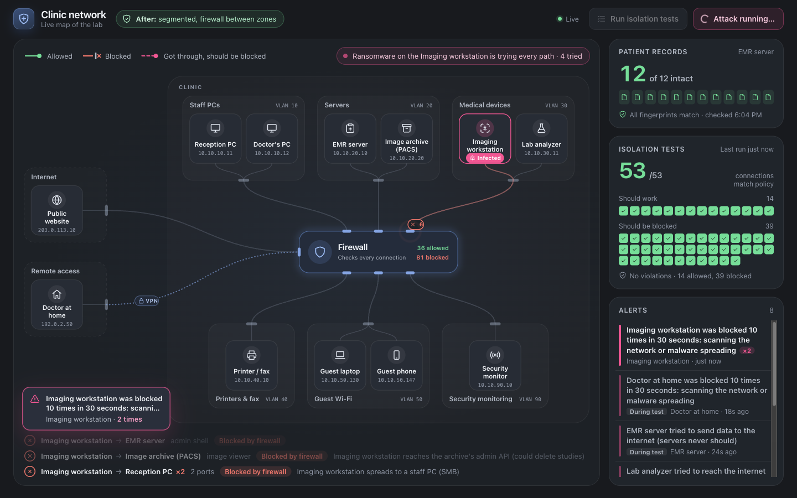
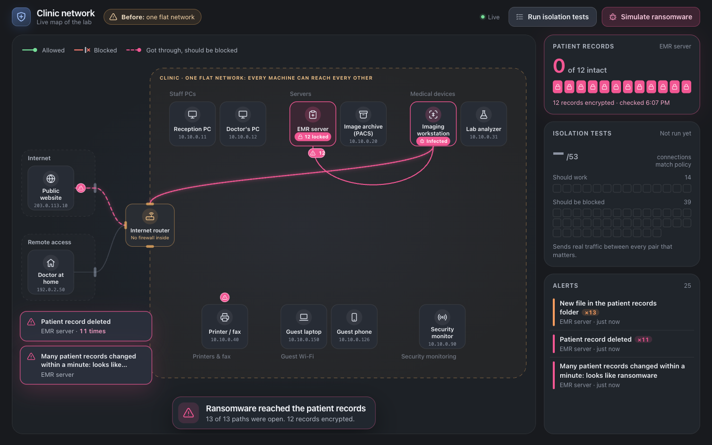
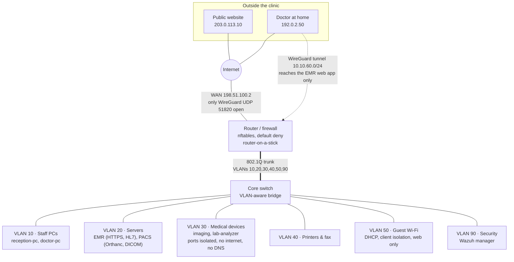

# clinic-net-lab

A small medical clinic's network, built as code. It has six segmented zones, a
default-deny firewall, real medical protocols, a VPN for remote doctors and a
security monitor. A test suite sends real traffic to prove that patient data
only flows where it should.

Everything runs in containers on one laptop. You need Docker and nothing else.



## The short version

A ransomware-infected imaging workstation tries every path an attacker would
(13 in all). The lab runs that attack twice:

| | Flat network (the "before") | Segmented network (this design) |
|---|---|---|
| Attack paths that got through | 13 of 13 | 1 of 13: sending images to the archive, its one job |
| Patient records encrypted | **12 of 12** | **0 of 12** |
| Isolation tests matching policy (53 flows) | 22 (30 violations, 1 broken) | **53** |
| What the security monitor saw | a file-integrity alert for each record, after the damage | "device tried the internet" and "scan" alerts, within about 2 seconds |



## Quickstart

```sh
git clone https://github.com/Davron2004/clinic-net-lab.git
cd clinic-net-lab
./lab up            # build and start the clinic, then the map
```

Open http://localhost:8080 and press **Simulate ransomware**, or **Run
isolation tests**. The terminal equivalents:

```sh
./lab test          # 53 flows, report in run/results/report.md
./lab attack        # the ransomware scenario
./lab up flat       # the flat "before" network, for comparison
./lab shell router  # look around (nft list ruleset, bridge vlan show, ...)
./lab down
```

The first run builds the images and pulls Wazuh (about 2.7 GB). After that,
`./lab up` takes about 25 seconds. `CLINIC_MONITORING=0 ./lab up` skips the
security monitor. Docker needs about 1 GB of memory for the lab. Tested on
macOS (Apple silicon, Docker Desktop) and on Ubuntu 24.04 (amd64, in CI).

## The network



| Zone | VLAN | Subnet | May start connections to |
|---|---|---|---|
| Staff PCs | 10 | 10.10.10.0/24 | EMR web app (443), image viewer (8042), printer (9100, 631), web (80, 443), DNS |
| Servers | 20 | 10.10.20.0/24 | nothing, except the EMR's security agent to the SIEM |
| Medical devices | 30 | 10.10.30.0/24 | imaging to the archive (DICOM 4242), lab analyzer to the EMR (HL7 2575); nothing else |
| Printers & fax | 40 | 10.10.40.0/24 | nothing |
| Guest Wi-Fi | 50 | 10.10.50.0/24 | web (80, 443) and DNS; not even each other |
| Security | 90 | 10.10.90.0/24 | nothing (agents connect to it) |
| Remote (VPN) | | 10.10.60.0/24 | the EMR web app only |

The firewall policy is in [`config/clinic/router/nftables.nft`](config/clinic/router/nftables.nft).
It's short enough to read in one sitting: one chain per zone, one line per
allowed path, and every allowed connection and every drop is logged with the
rule's name.

## How it is tested

[`policy/clinic.yml`](policy/clinic.yml) states the policy as 53 plain
expectations, for example "D08: imaging workstation reaches the patient records
share: deny". It is written separately from the firewall on purpose: if a
firewall rule is wrong, the test catches it instead of inheriting the mistake.

[`tests/isolation.py`](tests/isolation.py) runs each flow by sending real
traffic from the source machine. That covers TCP connects, HTTPS requests, DNS
lookups, DICOM echoes, HL7 messages that must be acknowledged, and tunnel and
non-tunnel paths. For every blocked flow it also checks that the target service
is actually running, so a "blocked" result can't just mean "nothing was
listening". It writes a compliance-style report with a fingerprint of the
firewall ruleset it tested.

[CI](.github/workflows/ci.yml) builds the whole clinic on a fresh Ubuntu
runner on every push. It then:

- requires 53/53 on the segmented network;
- runs the ransomware scenario and requires it to be contained;
- requires the suite to find violations on the flat network, and the attack to
  succeed there.

The last check proves the tests can fail.

## What's inside

| Piece | What it is |
|---|---|
| [`lab`](lab) | The CLI. It runs [containerlab](https://containerlab.dev) in a container, so macOS and Linux work the same way |
| [`topologies/`](topologies) | The segmented clinic and the flat "before", as containerlab topologies |
| [`config/`](config) | Router (interfaces, nftables, dnsmasq, WireGuard) and switch port maps, per network |
| [`images/node`](images/node) | One Debian image for every simulated machine. `ROLE`/`SERVICES` decide what it becomes |
| [`images/pacs`](images/pacs) | Orthanc, the image archive (PACS) |
| [`images/siem`](images/siem), [`images/agent`](images/agent) | Wazuh manager with the clinic's rules; Wazuh agents for the EMR (file integrity) and the router (firewall log) |
| [`policy/`](policy), [`tests/`](tests) | The 53-flow policy and the isolation test suite |
| [`scenarios/`](scenarios) | The ransomware scenario |
| [`map/`](map) | The live clinic map (Python standard library server and plain JavaScript, no build step) |
| [`learn/`](learn) | One doc per stage: concepts mapped to software ideas, plus "break it" exercises with answers |
| [`docs/phipa.md`](docs/phipa.md) | Each design choice mapped to Ontario's PHIPA, with verified citations |

All patient data is synthetic. Keys and passwords are generated when the lab
starts and are never committed.

## Limits, and what changes with 50 real machines

- **Simulated, not real hardware.** Containers stand in for PCs, and a Linux
  bridge stands in for a managed switch. The concepts carry over: VLANs, trunks,
  stateful filtering, NAT and VPN. Vendor configuration syntax doesn't.
- **Hardware.** A real clinic would use a managed switch with the same VLAN
  plan, Wi-Fi access points mapping SSIDs to VLANs, and a firewall appliance
  or a small Linux/BSD box running the same policy.
- **Addresses.** DHCP reservations for every machine would replace static
  addresses, and the firewall would refer to machines through named sets.
- **Remote access.** The VPN would need MFA. A WireGuard key is a device
  credential, not a person's identity.
- **Not covered.** There is no admin VLAN, no backups, no endpoint protection
  or patching. The network only limits where an infection can spread; it
  doesn't stop the infection.
- **Not compliance.** The lab is evidence of reasonable technical safeguards,
  not PHIPA compliance; [`docs/phipa.md`](docs/phipa.md) explains the
  difference.
